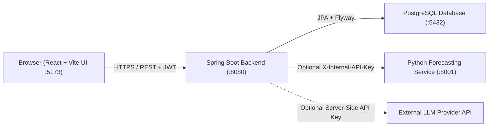

# SmartBiz

**SmartBiz** is an AI-integrated, cloud-based CRM and ERP management platform built for small and medium businesses. It brings customer pipeline tracking, inventory control, sales orders, invoicing, financial reporting, forecasting, and a permission-checked business assistant together in a single organization-isolated workspace.

---

## Key Features

- **Authentication & Organization Management:** Sign up, login, revocable session tokens, multi-organization switching, and role-based permissions (`OWNER`, `ADMIN`, `MANAGER`, `EMPLOYEE`).
- **Dashboard:** Organization-scoped overview of customers, open leads, pipeline breakdown, low-stock counts, order counts, revenue, and outstanding balances.
- **CRM:** Lead tracking, stage transitions, follow-up notes, customer directory, and idempotent lead-to-customer conversion.
- **Inventory & Suppliers:** Product catalog with SKU management, supplier links, low-stock thresholds, and auditable stock movements.
- **Sales & Finance:** Sales orders with atomic stock deductions, sequential invoice generation, and append-only payment/refund tracking.
- **Business Reports & Forecasting:** Date-filtered operational/financial reports, safe CSV exports, and optional statistical sales & product demand forecasting.
- **AI Assistant & Automation:** Controlled conversational assistant (with source citations and confirmation-gated write actions) plus deterministic low-stock and follow-up reminder alerts.
- **HR Module (Planned):** Navigation placeholder reserved for future HR features (`Scope Pending PRD`).

---

## Technology Stack

- **Frontend:** React 19, TypeScript, Vite, React Router, Lucide Icons
- **Backend:** Java 21 LTS, Spring Boot 3.3.5 (Spring Web, Spring Data JPA, Spring Security, Bean Validation, Actuator, OpenAPI/Swagger), Maven Wrapper (`3.9.9`)
- **Database:** PostgreSQL + Flyway schema migrations (`V1`–`V6`)
- **Optional Integrations:**
  - Python FastAPI + pandas + scikit-learn forecasting sidecar (`forecasting/`)
  - External OpenAI-compatible LLM Chat Completions API (server-side integration)

---

## Architecture Overview

SmartBiz runs as a modular monolith backend paired with a React single-page application and PostgreSQL database. All authentication, role checks, tenant isolation (`organization_id`), and financial/inventory transactions are enforced on the Java backend. Optional forecasting and AI assistant calls are routed securely from the backend, so the core platform continues functioning normally even when optional services are disabled.



### Repository Structure

```text
.
├── Guide.md                  # Beginner-friendly setup, run & test guide
├── README.md                 # Project overview and architecture
├── frontend/                 # React + TypeScript + Vite web app
│   ├── src/
│   │   ├── app/              # Auth context & role-aware navigation
│   │   ├── components/       # Layout shell & shared UI primitives
│   │   ├── design-system/    # CSS tokens & global styles
│   │   ├── lib/              # API client & typed domain models
│   │   └── pages/            # Application pages & Vitest tests
│   └── .env.example
├── backend/                  # Spring Boot modular monolith API
│   ├── src/main/java/com/nexusops/platform/
│   │   ├── assistant/        # Controlled AI assistant & tool gateway
│   │   ├── automation/       # Deterministic alerts & audit runs
│   │   ├── common/           # Shared envelopes & error handling
│   │   ├── config/           # Security, CORS, OpenAPI & Jackson config
│   │   ├── crm/              # Leads, customers & notes
│   │   ├── dashboard/        # Dashboard KPI summary service
│   │   ├── finance/          # Sales orders, invoices & payments
│   │   ├── health/           # Ping probe
│   │   ├── identity/         # Users, organizations, roles & sessions
│   │   ├── insights/         # Business reports, CSV export & forecasting client
│   │   ├── inventory/        # Products, suppliers & stock movements
│   │   └── security/         # JWT verification & tenant context
│   ├── src/main/resources/
│   │   ├── application*.yml  # Base, local & prod configurations
│   │   └── db/migration/     # Flyway SQL migrations (V1–V6)
│   ├── mvnw / mvnw.cmd       # Included Maven Wrapper
│   └── .env.example
├── forecasting/              # Optional Python FastAPI forecasting microservice
│   ├── app/                  # API endpoints & scikit-learn engine
│   ├── tests/                # Pytest suite
│   ├── requirements.txt
│   └── .env.example
└── docs/                     # Architecture & operational runbooks
```

---

## Documentation

For step-by-step instructions on installing tools, configuring environment files, setting up PostgreSQL, running the project locally, and running tests, see **[`Guide.md`](Guide.md)**.
